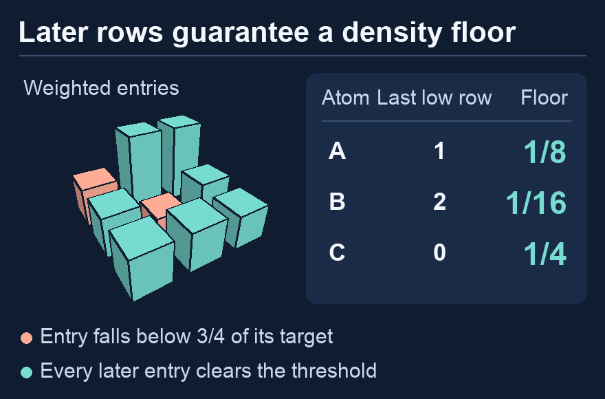

# Maximum description gain under arbitrary measurable mixtures

    

For a countably convex class of subprobabilities, the description-gain supremum is unchanged by arbitrary measurable mixtures or by closing the densities in L¹. All measures share a single σ-finite dominator. This answers the arbitrary-mixture question of Lardy, Grünwald and Harremoës. The equality includes infinite gains and requires no given finite-gain member.

[Read the paper](paper/manuscript.pdf) · [LaTeX source](paper/manuscript.tex) · [Original conjecture](https://ir.cwi.nl/pub/34437/34437.pdf#page=23) · [Lardy’s dissertation](https://ir.cwi.nl/pub/35219/ThesisLardy.pdf#page=231) · [Catalog Q760](https://github.com/10m-u/open-problems-catalog/blob/ca8d4d44ba3db527f19f28928c240168f545ecfe/problems/computer_science_ai/classical-statistical-machine-learning.md#q760) · [Version DOI](https://doi.org/10.5281/zenodo.24572497)

## Explore the proof in 3D

Take three atoms with target density 1/3 and tolerance 1/4. A falls below the 1/4 cutoff only in row 1, B only in row 2, and C never does. The weights after the last low row then certify the density floors 1/8, 1/16 and 1/4. The actual mixture densities are 1/4, 7/24 and 31/96.

[Download the offline explorer](https://raw.githubusercontent.com/DannyExperiments/choquet-mixtures-description-gain/v1.0.0/visualization/geometric-mixture-explorer.zip) · [Explorer source](visualization/index.html) · [Worked example](proof/worked-geometric-mixture.md) · [GIF rendering source](visualization/render.py)

## Why the proof works

The norm closure already contains every measurable barycenter by separation with bounded functions. Within the original countably convex class, choose approximants whose low-entry sets are sufficiently small under P. Weight the approximants geometrically. Beyond the last low row at any point, all remaining entries are near the target from below. The expected last low row controls the expected log loss. This gives gains arbitrarily close from below, including the infinite case.

Finite convexity with a finite-gain anchor admits a standard Fatou argument. The paper also explains the obstruction without an anchor and the separate failure without a common dominator. [Source comparison](audits/public_safe_reports/LITERATURE.md) · [Finite convexity note](proof/finite-convex-anchors.md)

## Reproduce the checks

    python3 -I scripts/verify_repository.py
    python3 -I verification/src/replay.py

The [recorded replay](verification/results/replay.txt) checks the geometric envelope, exact worked mixture and finite-support truncations. See [scope](CLAIM_SCOPE_AND_LIMITATIONS.md), [reproducibility](REPRODUCIBILITY.md), and the [research disclosure](AI_DISCLOSURE.md).

## Cite

DannyExperiments. *Maximum description gain under arbitrary measurable mixtures*. Version 1.0.0, 27 November 2026. [Version DOI](https://doi.org/10.5281/zenodo.24572497).

## Partial Lean verification

For finite lists of rational pointwise density values, a nonnegative initial segment of length N followed by terms and a terminal remainder of height at least c gives a geometric mixture of height at least c/2ᴺ. [Scope, source and replay](formalization/README.md)
